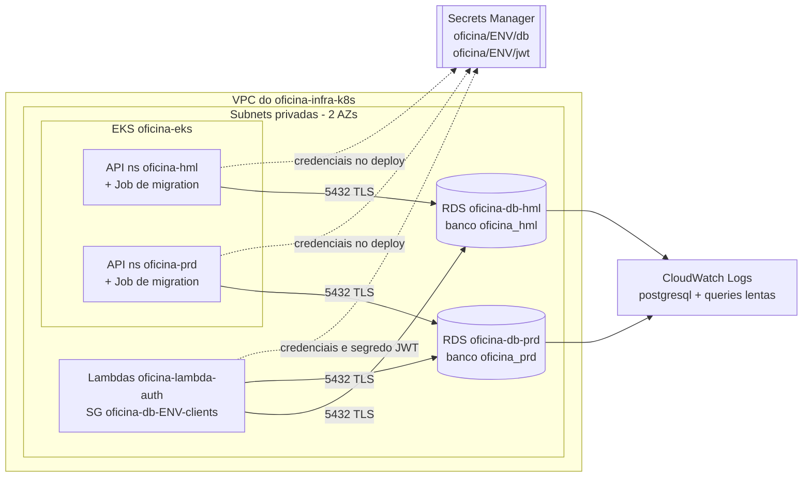

# oficina-infra-db

Infraestrutura como código (Terraform) do banco de dados gerenciado da **Oficina Mecânica**, projeto do Tech Challenge da Pós-Tech em Arquitetura de Software (FIAP), fase 3.

Provisiona, para cada ambiente, uma instância **Amazon RDS for PostgreSQL 16** em subnets privadas e publica as credenciais de conexão e o segredo de assinatura dos tokens JWT no **AWS Secrets Manager**, de onde são lidos pela API no EKS e pelas Lambdas de autenticação.

| Repositório | Responsabilidade |
| --- | --- |
| [tech-challenge](https://github.com/Guribeiro/tech-challenge) | Aplicação NestJS (schema Prisma, migrations e seed) |
| [oficina-infra-k8s](https://github.com/Guribeiro/oficina-infra-k8s) | VPC, EKS, ECR e API Gateway |
| **oficina-infra-db** (este) | Amazon RDS PostgreSQL e segredos no Secrets Manager |
| oficina-lambda-auth | Lambdas de autenticação por CPF e authorizer JWT |

## Tecnologias

- Terraform 1.13 (backend S3 com lock nativo, o mesmo bucket do `oficina-infra-k8s`)
- Amazon RDS for PostgreSQL 16 (`db.t3.micro`, gp3 criptografado)
- AWS Secrets Manager, Security Groups, CloudWatch Logs
- GitHub Actions (fmt, validate, tflint, plan e apply por ambiente)

## Arquitetura



### Recursos por ambiente

| Recurso | Configuração |
| --- | --- |
| `aws_db_instance` `oficina-db-<env>` | PostgreSQL 16, `db.t3.micro`, 20 GB gp3 (autoscaling até 50 GB), criptografado, privado, single-AZ, backup diário |
| Parameter group | `rds.force_ssl=1`, `log_min_duration_statement=500` (queries lentas), `log_lock_waits=1` |
| Security group `oficina-db-<env>` | Entrada 5432 somente do security group do cluster EKS e do SG `oficina-db-<env>-clients` |
| Security group `oficina-db-<env>-clients` | Anexado pelas Lambdas que precisam consultar o banco |
| Secret `oficina/<env>/db` | `{ engine, host, port, username, password, dbname }` |
| Secret `oficina/<env>/jwt` | `{ secret }`: chave HS256 compartilhada entre a Lambda (emite) e a API/authorizer (validam) |

### Por que PostgreSQL no Amazon RDS

- O domínio (clientes, veículos, ordens de serviço, orçamentos, itens, faturas) é fortemente relacional e depende de integridade referencial e transações: ao atualizar uma OS, os itens e o histórico de status precisam mudar juntos.
- A aplicação já usa PostgreSQL com Prisma desde a fase 1, sem custo de migração; recursos usados na modelagem desta fase, como enums, índices compostos e o trigger de histórico de status, são nativos do PostgreSQL.
- O RDS elimina a operação do banco dentro do cluster (na fase 2 ele rodava com armazenamento efêmero), com backups automáticos, criptografia, patches e logs gerenciados.

A justificativa completa, o diagrama ER e os ajustes no modelo relacional estão na documentação arquitetural do repositório [tech-challenge](https://github.com/Guribeiro/tech-challenge).

### Decisões para o AWS Learner Lab

- **Uma instância por ambiente** (em vez de dois bancos na mesma instância): o isolamento é real e o pipeline espelha os ambientes. Criar bancos e usuários adicionais exigiria acesso de rede do runner do GitHub ao RDS privado.
- **Single-AZ e sem snapshot final**: reduz custo e permite destruir o ambiente entre sessões do laboratório. Em produção real, o recomendado seria Multi-AZ, `deletion_protection` e snapshot final.
- **Sem Enhanced Monitoring e Performance Insights**: exigem role IAM ou chave KMS que o laboratório não permite criar. A observabilidade do banco vem dos logs do PostgreSQL no CloudWatch e das métricas de queries no APM do New Relic.
- **Segredos com `recovery_window_in_days = 0`**: permite recriar os segredos com o mesmo nome logo após um `destroy`.

## Pré-requisitos

- Plataforma do `oficina-infra-k8s` aplicada (VPC, subnets e security group do cluster são lidos do state dela)
- Bucket de state criado pelo `bootstrap/state.sh` do `oficina-infra-k8s`
- Terraform >= 1.10 e AWS CLI v2 com a sessão do Learner Lab

## Execução local

```bash
export TF_STATE_BUCKET=oficina-tfstate-<account_id>

./scripts/tf.sh hml plan
./scripts/tf.sh hml apply
./scripts/tf.sh hml output

# Conferir o segredo usado pelo deploy da aplicação
aws secretsmanager get-secret-value --secret-id oficina/hml/db --query SecretString --output text

# Destruir ao fim da sessão do laboratório
./scripts/tf.sh hml destroy
```

Depois do apply, o deploy da aplicação (`tech-challenge`, `scripts/deploy.sh <env>`) monta a `DATABASE_URL` a partir do segredo e executa as migrations do Prisma pelo Job no cluster.

## CI/CD

Workflow [`.github/workflows/terraform.yml`](.github/workflows/terraform.yml):

| Evento | Execução |
| --- | --- |
| Pull request para `develop` ou `main` | `validate` (fmt, validate, tflint) e `plan` do ambiente de destino (hml ou prd) |
| Push na `develop` | apply hml |
| Push na `main` | apply prd |
| `workflow_dispatch` | plan, apply ou destroy de um ambiente |

A `main` é protegida: alterações entram somente por pull request com o check `validate` aprovado. Os jobs que acessam a AWS só executam quando a variável `TF_STATE_BUCKET` está configurada.

### Configuração do GitHub

GitHub Environments `homologacao` e `producao` com os secrets `AWS_ACCESS_KEY_ID`, `AWS_SECRET_ACCESS_KEY` e `AWS_SESSION_TOKEN` (credenciais do Learner Lab, renovadas a cada sessão) e a variável de repositório `TF_STATE_BUCKET`.

## Outputs

| Output | Consumidor |
| --- | --- |
| `db_secret_arn`, `jwt_secret_arn` | oficina-lambda-auth (permissões e leitura dos segredos) |
| `db_client_security_group_id` | oficina-lambda-auth (SG das funções na VPC) |
| `db_address`, `db_port`, `db_name`, `db_security_group_id` | Diagnóstico e documentação |

## Deploys ativos e links

| Ambiente | API Gateway | Swagger | Autenticação por CPF |
| --- | --- | --- | --- |
| Homologação (`develop`) | https://0bagr12oql.execute-api.us-east-1.amazonaws.com | [/docs](https://0bagr12oql.execute-api.us-east-1.amazonaws.com/docs) | `POST https://0bagr12oql.execute-api.us-east-1.amazonaws.com/auth/cpf` |
| Produção (`main`) | https://cvqm7rpmdg.execute-api.us-east-1.amazonaws.com | [/docs](https://cvqm7rpmdg.execute-api.us-east-1.amazonaws.com/docs) | `POST https://cvqm7rpmdg.execute-api.us-east-1.amazonaws.com/auth/cpf` |

URLs da sessão de 16/11/2026. O ambiente roda no AWS Learner Lab e é destruído e recriado entre sessões (`scripts/bringup.sh` do [oficina-infra-k8s](https://github.com/Guribeiro/oficina-infra-k8s)), o que gera novas URLs.

- Coleção Postman (autenticação por CPF, authorizer e APIs protegidas): [oficina-fase3.postman_collection.json](https://github.com/Guribeiro/tech-challenge/blob/main/docs/postman/oficina-fase3.postman_collection.json)
- Documentação arquitetural (componentes, sequências, RFCs, ADRs, modelo de dados): [tech-challenge/docs](https://github.com/Guribeiro/tech-challenge/tree/main/docs)
- Modelo de dados e justificativa do PostgreSQL/RDS: [modelo-dados.md](https://github.com/Guribeiro/tech-challenge/blob/main/docs/modelo-dados.md) e [RFC 0002](https://github.com/Guribeiro/tech-challenge/blob/main/docs/rfcs/0002-banco-postgresql-rds.md)